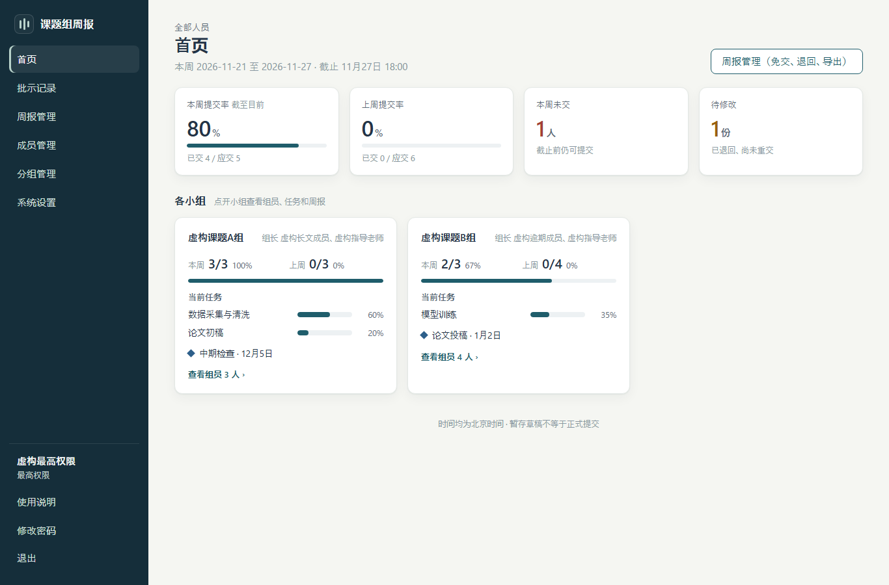
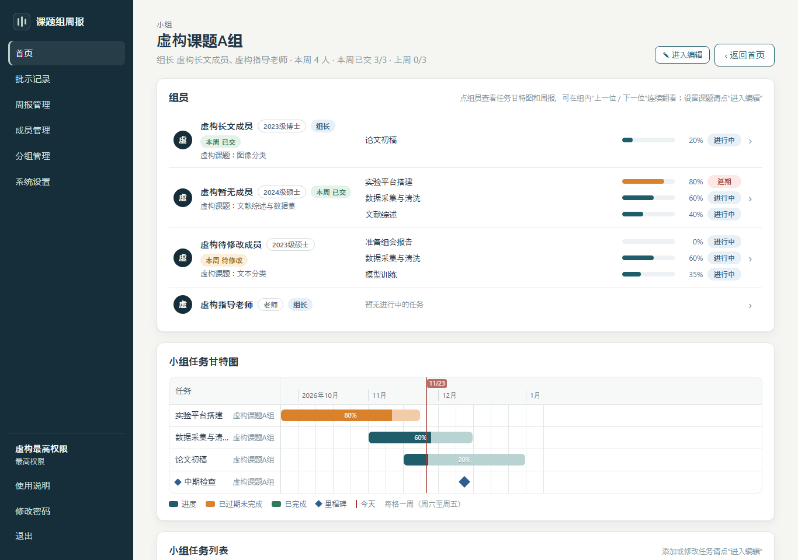
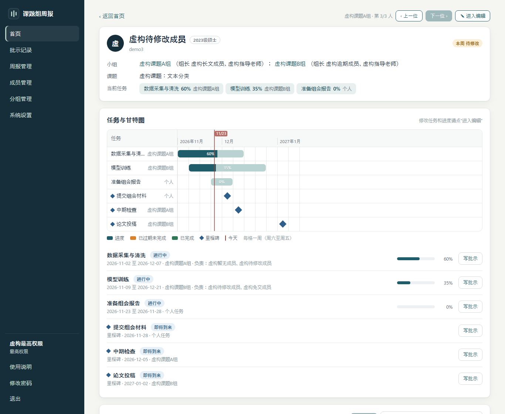
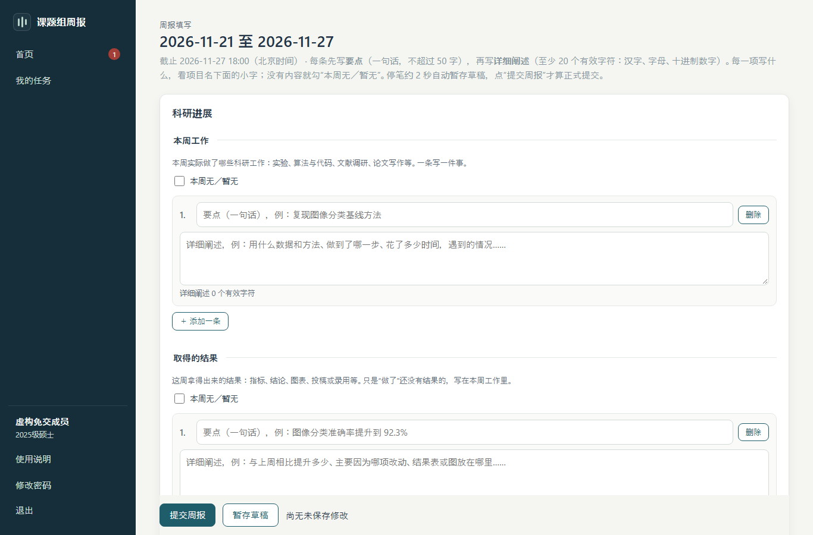

# 课题组周报管理系统

**南京邮电大学 FocusLab 实验室制作**

面向高校课题组和科研团队的周报平台：成员按统一结构写周报，组长和管理员在一个页面里看提交情况、任务进度和每个人的周报，并能写批示、收反馈、导出合订文档。

> **这不是开源软件。** 源代码可查看，可按 [LICENSE](LICENSE)（PolyForm Strict 1.0.0）用于非商业目的；**不得修改、不得再分发**，商业使用需取得著作权人书面授权。中文说明见 [NOTICE.md](NOTICE.md)。



## 功能

| 角色 | 能做什么 |
|---|---|
| **最高权限** | 查看全部人员；批量导入账号；管理分组和组长；写批示并查看反馈；免交、退回；导出合订 Word/PDF 和统计 Excel |
| **小组长** | 查看本组提交率、组员周报和任务；给组员派任务、设课题；退回周报；导出本组材料 |
| **组员** | 按引导填写周报；查看批示并反馈；规划个人任务、更新任务进度 |
| **老师** | 可以担任组长；周报选填，不计入提交率 |

其他特点：

- **周报结构统一**：科研进展、项目推进各四项，每条分“要点 + 详细阐述”，阅读时先看要点。
- **任务甘特图**：小组任务、个人任务和里程碑按周显示，红线标出今天。
- **数据可靠**：草稿与正式版本分开，正式版本只追加、不可修改，由数据库触发器保证；关键操作都有审计记录。
- **权限清晰**：页面默认只读，点“进入编辑”才能修改；一个人可以同时在多个小组。
- **部署轻量**：1 GB 内存的云服务器即可运行，不依赖外部 CDN，国内网络可用。

| 小组页 | 成员阅览 | 填写周报 |
|---|---|---|
|  |  |  |

## 快速试用

需要已安装 [Docker](https://docs.docker.com/get-docker/)（含 Docker Compose）：

```sh
git clone https://github.com/Kilimetarlop/weekly-report-system.git
cd weekly-report-system
cp .env.example .env
docker compose -f compose.yaml -f compose.dev.yaml up -d --build
docker compose -f compose.yaml -f compose.dev.yaml exec web python manage.py migrate
docker compose -f compose.yaml -f compose.dev.yaml exec web python manage.py init_admin --account admin --name 管理员
```

按提示设置密码后，打开 <http://localhost:8000> 登录。这种方式只用于本机试用；正式上线请看部署教程。

## 文档

| 文档 | 适合谁 | 内容 |
|---|---|---|
| [部署教程](docs/deployment.md) | 负责搭建系统的人 | 本机试用、云服务器上线、接入已有 Nginx、备份、恢复、升级、排错 |
| [使用入门](docs/user-guide/README.md) | 所有人 | 从建账号到第一份周报的完整流程 |
| [最高权限手册](docs/user-guide/admin.md) | 管理员 | 账号、分组、周报管理、批示、导出 |
| [小组长手册](docs/user-guide/leader.md) | 组长 | 查看组员、派任务、设课题、退回 |
| [组员手册](docs/user-guide/member.md) | 组员和老师 | 写周报、反馈批示、管理任务 |

系统登录后左下角的“使用说明”也有这三份手册，并可下载 Word 版。

## 技术栈

Python 3.12 · Django 5.2 · PostgreSQL 17 · Gunicorn · Caddy（可选）· LibreOffice（生成 PDF）· Docker Compose。第三方组件及其许可证见 [THIRD_PARTY_NOTICES.md](THIRD_PARTY_NOTICES.md)。

## 许可与版权

Copyright (c) 2026 Kilimetarlop。

本软件按 [PolyForm Strict License 1.0.0](LICENSE) 提供。需要商业使用、修改或再分发授权，请通过 GitHub 联系著作权人。
