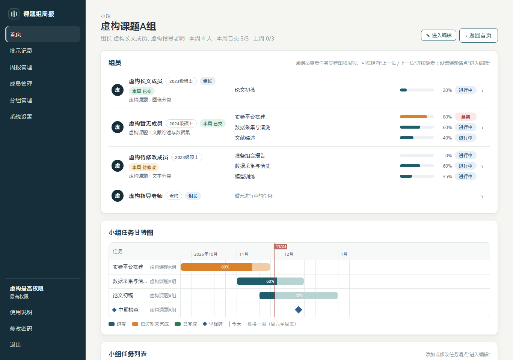
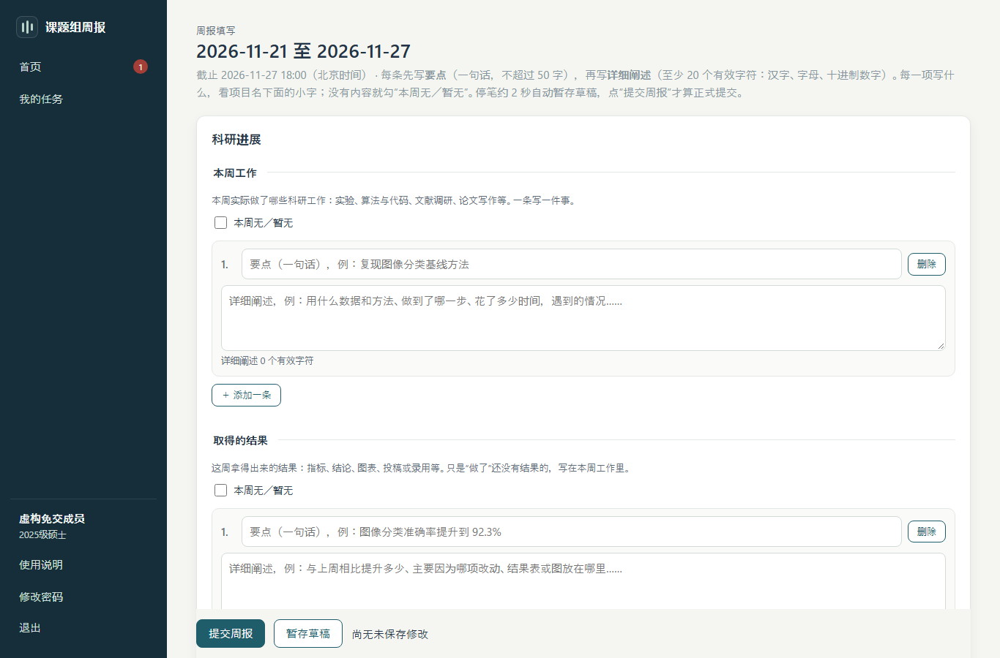
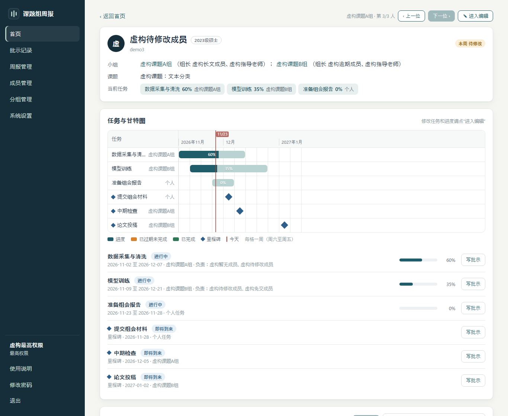

# 使用入门

这篇带你走完一轮：从建账号，到收齐第一周周报。系统还没搭好的话，先看[部署教程](../deployment.md)。

## 先认识三个角色

| 角色 | 是谁 | 主要做什么 | 详细手册 |
|---|---|---|---|
| 最高权限 | 课题组管理员 | 建账号、分组、看全局、写批示 | [最高权限手册](admin.md) |
| 小组长 | 各小组负责人（学生或老师） | 看本组、派任务、设课题、退回 | [小组长手册](leader.md) |
| 组员 | 写周报的成员 | 写周报、反馈批示、更新任务 | [组员手册](member.md) |

老师也可以写周报，但这是选填的：不写不算未交，写了也不计入提交率。

## 第一步：管理员导入成员

1. 用管理员账号登录，进入 **成员管理 → 批量导入**。
2. 在 Excel 或 WPS 里准备一张表，选中后复制，粘贴到文本框：

   | 姓名 | 年级 | 课题名称 | 所在小组 | 担任组长的小组 | 账号 |
   |---|---|---|---|---|---|
   | 张三 | 老师 | | A组 | A组 | zhangsan |
   | 李四 | 2024级博士 | 图像分类 | A组 | | lisi |
   | 王五 | 2026级硕士 | 模型压缩 | A组 | | wangwu |

   只有“姓名”必填。“年级”写成 `2026级硕士`、`2024级博士` 或 `老师`。表里出现的新小组会自动创建。
3. 点 **检查**，确认没有错误后点 **导入**。
4. 导入完成页会显示自动生成的初始密码，**只显示这一次**。点“下载账号和初始密码”，分别发给本人，发完删除这个文件。

以后加人时，点 **下载成员表**，在后面补几行再导入即可。已有的人不会重复创建，密码、姓名和分组也不会被改动。

## 第二步：组长安排工作

1. 组长登录后进入 **小组概览**，点左侧的小组名。
2. 点右上角 **进入编辑**。
3. 在组员下方填写 **课题**，点“保存”。
4. 在 **添加小组任务** 里填任务名称和起止日期，勾选负责人。
5. 改完点顶部横幅上的 **完成编辑**。

## 第三步：组员写周报

1. 登录后点 **填写本周周报**。
2. 每一项下面都有一行说明。有内容就写“要点”（一句话）和“详细阐述”；这周确实没有就勾 **本周无／暂无**。
3. 八项都处理好后，点 **提交周报**。

系统会自动暂存草稿，但**草稿不算提交**。默认截止时间是每周五 18:00（北京时间），截止前可以反复修改。

## 第四步：查看和反馈

- **组长**：在小组页点组员，看任务甘特图和周报。周报先列要点，点开看详细阐述；用“上一位 / 下一位”连续翻看。需要补充时，进入编辑后点 **退回修改** 并写明原因。
- **管理员**：首页看提交率，点小组卡片进入。在周报、任务或小组上 **写批示**。
- **收到批示的人**：在首页选择 **已知悉 / 已落实 / 有困难**，可以附一句说明。管理员会在首页看到反馈。

## 第五步：导出

进入 **周报管理**，勾选人员后可以生成合订的 **Word / PDF**，或下载统计 **Excel**。生成在后台进行，完成后在“导出任务”里下载。

## 常见疑问

| 问题 | 怎么办 |
|---|---|
| 忘记密码 | 组长和组员找管理员在“成员管理”里重置 |
| 登录提示已暂停 | 同一账号连续输错 10 次会暂停 10 分钟；管理员重置密码可立即解除 |
| 看不到修改按钮 | 先点页面右上角“进入编辑” |
| 截止后想改周报 | 请组长或管理员退回，修改后重新提交 |
| 这周请假 | 请组长或管理员在“周报管理”里设为免交 |
